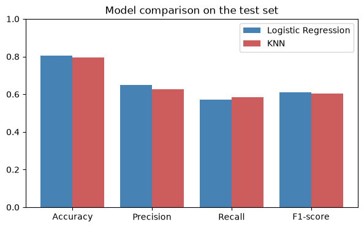
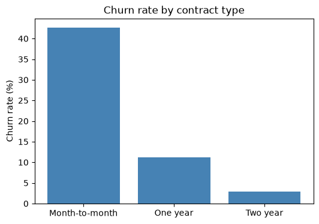

# Customer Churn Prediction System

An end-to-end machine learning project that predicts whether a telecom customer will leave the company, using Logistic Regression and K-Nearest Neighbours.

This is my final project for the Artificial Intelligence course (Batch 3) at Hunarmand Punjab.

## Results

Scores on the test set (1,407 customers):

| Model | Accuracy | Precision | Recall | F1-score |
|---|---|---|---|---|
| Baseline (always No) | 0.734 | 0.000 | 0.000 | 0.000 |
| **Logistic Regression** | **0.805** | **0.650** | **0.572** | **0.609** |
| KNN (K=35) | 0.797 | 0.626 | 0.586 | 0.605 |

The two models are very close. I chose Logistic Regression because it is simpler and easier to explain. The main limit is recall, as the model still misses about 4 in 10 churners.



## Key findings

- Month-to-month customers churned at 42.7%, compared to 2.8% on two year contracts.
- The typical customer who left had 10 months of tenure, while the typical customer who stayed had 38.
- Fiber optic customers churned at 41.9%, compared to 19.0% on DSL.



## Dataset

[IBM Telco Customer Churn](https://github.com/IBM/telco-customer-churn-on-icp4d): 7,043 customers and 21 columns. About 26.5% of the customers churned, so the classes are imbalanced.

## Approach

1. Explore the data with Pandas and Matplotlib.
2. Fix `TotalCharges`. It was read as text because 11 cells contain a blank space, which `isnull()` does not detect. All 11 are new customers with a tenure of 0 who have not been billed yet, so these rows are dropped.
3. Encode the text columns: label encoding for two values, one-hot encoding for more than two.
4. Split into 80% train and 20% test, keeping the same churn rate in both.
5. Scale `tenure`, `MonthlyCharges` and `TotalCharges`. The scaler is fitted on the training data only to avoid data leakage.
6. Train Logistic Regression and KNN. K is chosen with 5-fold cross validation on the training data.
7. Compare the models with accuracy, precision, recall, F1-score and confusion matrices, against a baseline that always says "No churn".
8. Check overfitting and underfitting by comparing training and test scores.

| Model | Train F1 | Test F1 | Result |
|---|---|---|---|
| KNN (K=1) | 0.997 | 0.519 | Overfitting |
| KNN (K=35) | 0.618 | 0.605 | Good fit |
| Logistic Regression | 0.600 | 0.609 | Good fit |
| KNN (K=3001) | 0.000 | 0.000 | Underfitting |

## Project structure

```text
├── churn_prediction.ipynb   Full project notebook
├── data/                    Dataset
├── outputs/                 Charts and result tables
├── report/                  Project report
└── requirements.txt         Libraries needed
```

## Tech stack

Python, Pandas, NumPy, Matplotlib, scikit-learn, Jupyter

## How to run

Use Python 3.12.

```bash
pip install -r requirements.txt
jupyter notebook churn_prediction.ipynb
```

Then choose Run All.
